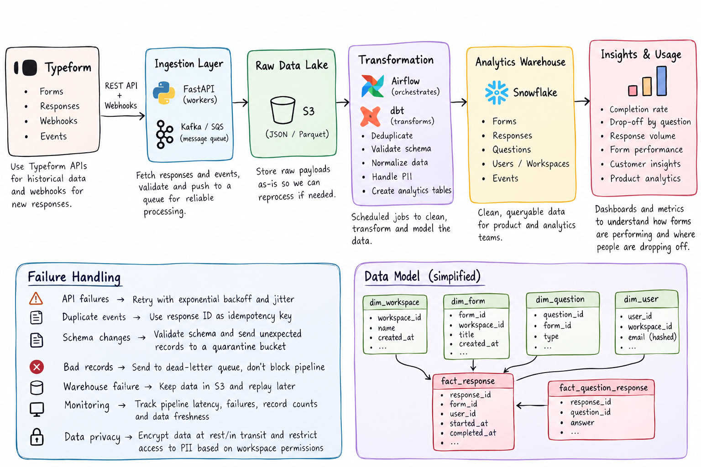

# Typeform Data Pipeline

## Overview

The goal of this pipeline is to collect Typeform response data and turn it into a clean dataset that can be used by analytics and product teams.

The main flow is:

Typeform → Ingestion → S3 → Transformation → Snowflake → Analytics

## Pipeline

### 1. Data ingestion

I would use the Typeform API to pull historical data and webhooks for new responses.

A small ingestion service would validate the incoming data and push it to a queue. This keeps the API layer separate from the processing layer and helps handle temporary failures.

### 2. Raw data

The incoming JSON would first be stored in S3.

I prefer keeping the raw data because it gives us a way to replay the pipeline if something goes wrong later or if the transformation logic changes.

### 3. Transformation

Airflow would handle scheduling and orchestration, while dbt would be used for the actual transformations.

The main steps would be:

- Remove duplicate responses
- Validate the incoming schema
- Normalize the response data
- Handle sensitive fields
- Build tables for forms, questions, users, and responses

### 4. Analytics

The cleaned data would be stored in Snowflake.

A simple model could contain:

- `dim_workspace`
- `dim_form`
- `dim_question`
- `dim_user`
- `fact_response`
- `fact_question_response`

This would allow the analytics team to look at things like response volume, completion rate, question-level drop-off, and form performance.

## Failure handling

A few things I would specifically handle:

- **API failures:** retry with exponential backoff
- **Duplicate responses:** use the response ID as an idempotency key
- **Unexpected schema:** quarantine the record instead of stopping the whole pipeline
- **Bad records:** send them to a dead-letter queue
- **Warehouse failures:** keep the data in S3 and replay it later
- **Pipeline issues:** monitor failures, latency, record counts, and data freshness

## Why this design?

I wanted to keep the pipeline relatively simple while making it reliable.

The raw S3 layer gives us a recovery point, the queue prevents temporary downstream issues from losing data, and the warehouse provides a clean layer for analytics.
